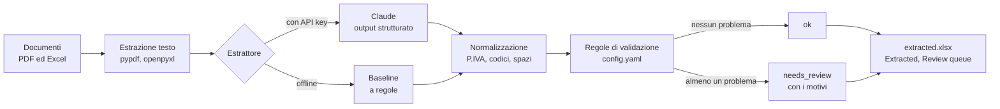

# Estrazione dati da contratti con AI

*[Read in English](README.md)*

Quando un nuovo cliente firma, qualcuno deve leggere il contratto e riportare i dati nel CRM e nel sistema di fatturazione: ragione sociale, partita IVA, sede legale, data di decorrenza, durata, canone annuo, costo di attivazione, numero di dipendenti, termini di pagamento. I documenti non sono mai uguali. Un cliente rimanda il PDF del contratto firmato, un altro un modulo di attivazione, un partner manda un foglio Excel, e ogni tanto arriva una scansione un po' storta. Ogni campo può essere scritto in tre modi diversi.

Le espressioni regolari funzionano su un modello e si rompono sul successivo. Un LLM li legge tutti senza problemi, ma può anche restituire una partita IVA formattata alla perfezione e sbagliata, e nessuno se ne accorge finché non torna indietro la prima fattura.

L'idea alla base del progetto è semplice: **l'LLM legge, regole deterministiche decidono di cosa ci si può fidare, e una persona controlla il resto.** È una versione piccola ma completa di un processo su cui lavoro come operations data analyst. I contratti veri restano in azienda, quindi qui tutto gira su documenti sintetici generati con un seed fisso.

## Cosa controlla

Ogni record estratto passa dalle stesse regole, qualunque sia l'estrattore che l'ha prodotto. Un record senza problemi è `ok`. Tutto il resto è `needs_review`, con l'elenco dei motivi, e niente in quello stato viene caricato in automatico.

| Controllo | Cosa significa in pratica |
|---|---|
| `missing:<campo>` | Manca un campo obbligatorio. Senza, il cliente non si può censire. |
| `vat_checksum` / `vat_format` | La partita IVA non supera la cifra di controllo, o non ha 11 cifre. Di solito è un refuso nel contratto stesso. |
| `vat_is_own_company` | La partita IVA trovata è la nostra. L'estrattore ha preso il fornitore al posto del cliente. |
| `tax_code_format` | Il codice fiscale non è né un codice societario valido di 11 cifre né uno personale di 16 caratteri. |
| `invalid_province` / `zip_format` | La sigla non è una provincia italiana, o il CAP non ha 5 cifre. |
| `email_format` | Così com'è scritta, l'email del referente non può ricevere posta. |
| `end_date_mismatch` | Decorrenza più durata non dà la scadenza scritta nel contratto. |
| `unusual_duration` | Durata fuori dai valori ammessi (12, 24, 36 mesi...). |
| `annual_fee_out_of_range` / `setup_fee_out_of_range` | Importo fuori da un intervallo plausibile, o attivazione più alta del canone annuo. Uno zero di troppo ha esattamente questo aspetto. |
| `employees_out_of_range` | Numero di dipendenti fuori da un intervallo plausibile. |
| `not_signed` / `signed_without_date` | Manca la firma del cliente, oppure c'è una firma senza data, che in pratica vuol dire che qualcuno ha letto male la pagina. |
| `signature_after_start` | Firmato dopo l'avvio del servizio. Può succedere, ma qualcuno deve saperlo. |
| `not_in_source:<campo>` | Partita IVA, codice fiscale, CAP o email non compaiono letteralmente nel documento. Il valore è arrivato da qualche altra parte. |
| `extraction_failed` | La chiamata all'API è fallita o il modello ha rifiutato. Il documento va a una persona, non in un ciclo di tentativi. |

## Come funziona



Alcune scelte che vale la pena spiegare.

**Un solo schema per tutto.** Il record di destinazione è un modello Pydantic ([schema.py](contract_extraction/schema.py)) con 19 campi, tutti facoltativi. Lo stesso modello è lo schema di output strutturato inviato a Claude, il tipo restituito dalla baseline e il formato della ground truth. Così non ci si chiede mai se due cose siano confrontabili: sono lo stesso tipo.

**Meglio un campo vuoto che un'ipotesi.** Il prompt chiede al modello di copiare solo ciò che è scritto, restituire null per tutto quello che manca o è ambiguo, e non calcolare niente, nemmeno una scadenza che potrebbe ricavare facilmente da decorrenza e durata. Chiede anche di copiare gli identificativi esattamente come sono, anche quando sembrano sbagliati. Se il modello "corregge" una partita IVA con la cifra di controllo errata, la validazione non può più segnalarla e il refuso del cliente sparisce senza lasciare traccia.

**Decidono le regole, non il modello.** Non ho chiesto al modello un punteggio di confidenza. Una confidenza autodichiarata non è qualcosa che posso verificare, e non mi dice quale campo guardare. I controlli in [validation.py](contract_extraction/validation.py) sono Python semplice con una risposta certa: la cifra di controllo della partita IVA, il formato del codice fiscale, decorrenza più durata contro scadenza, intervalli degli importi, sigle di provincia reali. Le soglie stanno in [config.yaml](config.yaml), perché sono decisioni di business.

**Il valore deve stare nel documento.** Per gli identificativi c'è un controllo che non costa niente e intercetta il tipo di errore più pericoloso di un LLM: le cifre della partita IVA, il CAP, il codice fiscale e l'email devono comparire letteralmente nel testo di partenza, ignorando spazi e punteggiatura. Una partita IVA ben formattata che nel contratto non c'è è peggio di un campo vuoto.

**Una baseline che gira senza chiave.** L'estrattore a regole usa etichette ed espressioni regolari, come si automatizza di solito questo lavoro prima di coinvolgere un LLM. Permette di far girare tutto il repository e passare i test offline, ed è un riferimento onesto: se la cava bene sui moduli fissi e crolla sul testo libero. Durante lo sviluppo mi ha dato esempi da manuale. Ha preso la "E" che unisce le due parti ("tra Esempio Servizi e Rossi S.r.l.") come parte della ragione sociale del cliente. Ha letto "90 giorni di preavviso" della clausola di disdetta come termini di pagamento. E ha letto la riga "Firmato digitalmente" del fornitore come firma del cliente, quindi il primo giro ha approvato un contratto non firmato. Quest'ultimo è il motivo per cui esiste `signed_without_date`: una firma vera ha sempre una data.

**Testato su una risposta nota.** Il generatore inserisce un problema in dieci dei 24 documenti (una cifra di controllo sbagliata, una scadenza che non torna con la durata, un'email senza dominio di primo livello, un canone con uno zero di troppo...) e lo scrive nella ground truth. Un test applica le regole alla ground truth e si aspetta esattamente quei problemi, niente di più. È servito subito: la prima volta che l'ho lanciato, due documenti avevano un `tax_code_format` in più, perché il generatore copiava la partita IVA sbagliata anche nel codice fiscale. L'errore era nel mio generatore, non nella regola.

## Come si lancia

```bash
pip install -r requirements.txt
python -m contract_extraction generate                               # 24 documenti sintetici + ground truth
python -m contract_extraction run --input samples/ --extractor auto  # scrive output/extracted.xlsx e .csv
python -m contract_extraction evaluate --extractor rules             # accuratezza rispetto alla ground truth
python -m pytest
```

`--extractor auto` usa Claude se `ANTHROPIC_API_KEY` è impostata e la baseline altrimenti, e dice quale ha scelto. L'output completo sui documenti di esempio è riportato nel [README in inglese](README.md#run-it). In sintesi, con la baseline: 7 documenti `ok` e 17 in revisione, precisione complessiva del 97% e recall dell'83%, nessun record `ok` con un valore sbagliato, 7 problemi inseriti su 10 segnalati con il motivo atteso.

Come leggere questi numeri. La baseline è precisa ma perde molto: quando un'etichetta non è dove se l'aspetta non restituisce niente, e un campo obbligatorio vuoto manda il record in revisione. È il comportamento che voglio da qualsiasi estrattore. Sullo zero di record `ok` con errori però devo essere onesto: cinque delle sette ragioni sociali sbagliate vengono dai contratti, finiti in revisione per un altro motivo (la data di firma che la baseline non riesce a leggere), e le altre due dagli Excel in formato export, finiti in revisione con metà dei campi vuoti. Nessuna regola in questo repository verifica che la ragione sociale sia giusta. Dei tre problemi inseriti non segnalati con il motivo atteso, due sono comunque in revisione per un'altra ragione; il terzo (doc_17, un codice fiscale con una cifra in meno) è stato approvato con il codice fiscale vuoto, perché la baseline non l'ha mai trovato.

**Su Claude.** I numeri sono solo quelli della baseline. L'estrattore Claude è scritto e testato con un client simulato, ma per questo README non l'ho eseguito sull'API, quindi qui non ci sono numeri di Claude e non ne invento. Per riprodurre con Claude:

```bash
export ANTHROPIC_API_KEY=...        # PowerShell: $env:ANTHROPIC_API_KEY="..."
python -m contract_extraction evaluate --extractor claude
```

Il risultato viene salvato in `reports/evaluation_claude.csv`, accanto a quello della baseline. Il modello si imposta in [config.yaml](config.yaml) (`claude-sonnet-5-5` di default).

I file di output sono già nelle cartelle [output/](output/) e [reports/](reports/), e i documenti di esempio in [samples/](samples/), per chi vuole solo vedere com'è fatto il risultato.

## Struttura

```
contract_extraction/
  schema.py       il record di destinazione (Pydantic), comune a estrattori e ground truth
  text.py         da PDF ed Excel a testo semplice
  extractors.py   interfaccia Extractor, ClaudeExtractor, RuleBasedExtractor
  validation.py   controlli deterministici e normalizzazione
  pipeline.py     elabora una cartella dall'inizio alla fine, scrive Excel e CSV
  evaluate.py     accuratezza, precisione e recall per campo rispetto alla ground truth
  generate.py     documenti sintetici e ground truth
  parsing.py      date, importi e partite IVA all'italiana
samples/          24 documenti sintetici: 20 PDF in cinque layout, 4 moduli Excel
ground_truth/     un JSON per documento, con l'eventuale problema inserito
output/           extracted.xlsx (Extracted, Review queue) ed extracted.csv
reports/          risultati della valutazione
tests/            parsing, regole di validazione, estrattori (Claude simulato, nessuna chiamata di rete)
config.yaml       modello, soglie, campi obbligatori, sigle di provincia
```

## Dai dati sintetici a quelli veri

Con i contratti veri la struttura resta la stessa e si aggiunge qualche pezzo. I documenti arrivano da una casella di posta o da una cartella condivisa invece che da una cartella di esempi, e le scansioni vere hanno bisogno di un passaggio di OCR prima dell'estrazione del testo. La coda di revisione diventa una lista condivisa dove un collega conferma o corregge ogni record, e le correzioni vanno conservate: sono il miglior set di test che si possa avere. La lacuna più grande di questa versione è la ragione sociale. Il modo per chiuderla è cercare la partita IVA nel registro delle imprese e confrontare la denominazione ufficiale con quella estratta, più un controllo sul CRM per i clienti già presenti. L'ultimo passo è caricare i record `ok` tramite l'import o le API del CRM, che nel lavoro di tutti i giorni per me di solito vuol dire un flusso Power Automate.

## Strumenti

Python, Anthropic API (output strutturati), Pydantic, pandas, pypdf, openpyxl, fpdf2, pytest.

Tutti i documenti di questo repository sono sintetici e vengono generati da [generate.py](contract_extraction/generate.py). I nomi di aziende e persone arrivano da Faker, le partite IVA sono cifre casuali con una cifra di controllo valida, e il fornitore "Esempio Servizi S.r.l." non esiste.

## Progetti collegati

Questo repository fa parte di un piccolo portfolio costruito attorno allo stesso tipo di lavoro. La [pagina profilo](https://github.com/messimarco0701) spiega come si incastrano i pezzi.

| Progetto | |
|---|---|
| [crm-api-extractor](https://github.com/messimarco0701/crm-api-extractor) | Estrarre i dati dal CRM |
| [crm-billing-reconciliation](https://github.com/messimarco0701/crm-billing-reconciliation) | Controllarli con la fatturazione |
| [sales-pipeline-analytics](https://github.com/messimarco0701/sales-pipeline-analytics) | Analizzarli con SQL e Python |
| [powerbi-sales-dashboard](https://github.com/messimarco0701/powerbi-sales-dashboard) | Metterli davanti alle persone |
| [ai-contract-extraction](https://github.com/messimarco0701/ai-contract-extraction) | Portare i nuovi clienti nei sistemi |
