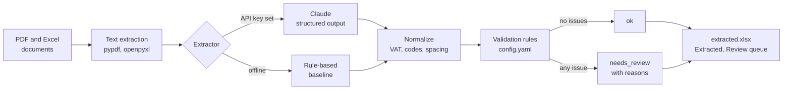

# AI Contract Extraction

*[Leggi in italiano](README.it.md)*

When a new customer signs, someone has to read the contract and type the details into the CRM and the billing system: company name, VAT number, registered address, start date, duration, annual fee, setup fee, number of employees, payment terms. The documents never look the same. One customer sends back the signed PDF contract, another an activation form, a partner sends an Excel sheet, and the occasional scan comes in slightly crooked. Every field can be written in three different ways.

Regular expressions work on one template and break on the next. An LLM reads all of them without trouble, but it can also return a VAT number that looks perfect and is wrong, and nobody would notice until the first invoice bounces.

So the idea behind this project is simple: **the LLM does the reading, deterministic rules decide what can be trusted, and a person checks the rest.** It is a small, complete version of a process I work on as an operations data analyst. The real contracts stay at work, so everything here runs on synthetic documents I generate with a fixed seed.

## What it checks

Every extracted record goes through the same rules, whatever produced it. A record with no issues is `ok`. Anything else is `needs_review`, with the reasons listed, and nothing in that state is loaded automatically.

| Check | What it means in practice |
|---|---|
| `missing:<field>` | A mandatory field is empty. The customer can't be set up without it. |
| `vat_checksum` / `vat_format` | The partita IVA doesn't pass the check digit, or isn't 11 digits. Usually a typo in the contract itself. |
| `vat_is_own_company` | The VAT found is ours. The extractor picked up the supplier instead of the customer. |
| `tax_code_format` | The codice fiscale is neither a valid 11 digit company code nor a 16 character personal one. |
| `invalid_province` / `zip_format` | Province is not a real Italian province code, or the CAP isn't 5 digits. |
| `email_format` | The contact email can't receive mail as written. |
| `end_date_mismatch` | Start date plus duration doesn't give the end date written in the contract. |
| `unusual_duration` | Duration outside the allowed values (12, 24, 36 months...). |
| `annual_fee_out_of_range` / `setup_fee_out_of_range` | Fee outside a plausible range, or setup fee higher than the annual fee. An extra zero looks exactly like this. |
| `employees_out_of_range` | Headcount outside a plausible range. |
| `not_signed` / `signed_without_date` | No customer signature, or a signature with no date, which in practice means somebody misread the page. |
| `signature_after_start` | Signed after the service started. Possible, but someone should know. |
| `not_in_source:<field>` | VAT, tax code, CAP or email are not literally in the document. The value came from somewhere else. |
| `extraction_failed` | The API call failed or the model declined. The document goes to a person, not to a retry loop. |

## How it works



A few choices worth explaining.

**One schema for everything.** The target record is a Pydantic model ([schema.py](contract_extraction/schema.py)) with 19 fields, all optional. The same model is the structured output schema sent to Claude, the return type of the baseline and the format of the ground truth. That way there is never a question of whether two things are comparable: they are the same type.

**Null is better than a guess.** The prompt tells the model to copy only what is written, return null for anything missing or ambiguous, and not compute anything, not even an end date that it could easily derive from start and duration. It also says to copy identifiers exactly, even when they look wrong. If the model "fixes" a VAT number with a bad check digit, the validation can't flag it anymore, and the customer's actual typo disappears without a trace.

**Rules decide, not the model.** I didn't ask the model for a confidence score. A self-reported confidence is not something I can audit, and it doesn't tell me which field to look at. The checks in [validation.py](contract_extraction/validation.py) are plain Python with a fixed answer: the partita IVA check digit, the codice fiscale pattern, start plus duration against end date, fee ranges, real province codes. The thresholds live in [config.yaml](config.yaml), because they are business decisions.

**The value has to be in the document.** For identifiers there is a cheap check that catches the most dangerous kind of LLM error: the digits of the VAT number, the CAP, the tax code and the email must literally appear in the source text, ignoring spaces and punctuation. A well formatted VAT number that isn't in the contract is worse than an empty field.

**A baseline that runs without a key.** The rule-based extractor uses labels and regular expressions, the way this is usually automated before anyone involves an LLM. It lets the whole repo run and the tests pass offline, and it is an honest reference: it does fine on fixed forms and falls apart on free text. The build gave me some textbook examples. It took the "E" that joins the two parties ("tra Esempio Servizi e Rossi S.r.l.") as part of the customer's name. It read "90 giorni di preavviso" from the termination clause as payment terms. And it read the supplier's "Firmato digitalmente" line as the customer's signature, so the first run approved an unsigned contract. That last one is why `signed_without_date` exists: a real signature always comes with a date.

**Tested against a known answer.** The generator plants one problem in ten of the 24 documents (a wrong check digit, an end date that doesn't match the duration, an email without a domain suffix, a fee with one zero too many...) and writes it into the ground truth. A test runs the rules on the ground truth and expects exactly those problems, nothing more. It paid off immediately: the first time I ran it, two documents came out with an extra `tax_code_format`, because the generator was copying the broken VAT number into the tax code as well. The bug was in my generator, not in the rule.

## Run it

```bash
pip install -r requirements.txt
python -m contract_extraction generate                               # 24 synthetic documents + ground truth
python -m contract_extraction run --input samples/ --extractor auto  # writes output/extracted.xlsx and .csv
python -m contract_extraction evaluate --extractor rules             # accuracy against the ground truth
python -m pytest
```

`--extractor auto` uses Claude when `ANTHROPIC_API_KEY` is set and the baseline otherwise, and says which one it picked. Output of `run` on the sample documents, without a key:

```
ANTHROPIC_API_KEY not set: using the offline rule-based baseline.
Documents: 24   ok: 7   needs_review: 17

Review queue:
  doc_01  signed_without_date
  doc_03  missing:annual_fee
  doc_06  vat_checksum; signed_without_date
  doc_08  missing:vat_number; missing:annual_fee
  doc_09  end_date_mismatch
  doc_10  missing:vat_number; missing:zip_code; missing:city; missing:province; missing:start_date; missing:duration_months; missing:annual_fee; missing:signed
  doc_11  signed_without_date
  doc_12  email_format
  doc_13  missing:annual_fee
  doc_14  missing:zip_code; missing:city; missing:province
  doc_15  vat_checksum
  doc_16  annual_fee_out_of_range; signed_without_date
  doc_18  missing:annual_fee; signature_after_start
  doc_20  missing:vat_number; missing:zip_code; missing:city; missing:province; missing:start_date; missing:duration_months; missing:annual_fee; missing:signed
  doc_21  missing:vat_number
  doc_22  signed_without_date
  doc_24  missing:annual_fee

Written output\extracted.xlsx and extracted.csv
```

And the evaluation of the baseline:

```
Extractor: rules   Documents: 24

             field  correct  wrong  missed  invented  correct_null accuracy precision recall
      company_name       17      7       0         0             0      71%       71%    71%
        vat_number       20      0       3         0             1      88%      100%    87%
          tax_code        8      0      12         0             4      50%      100%    40%
            street       24      0       0         0             0     100%      100%   100%
          zip_code       21      0       3         0             0      88%      100%    88%
              city       21      0       3         0             0      88%      100%    88%
          province       21      0       3         0             0      88%      100%    88%
      contact_name       22      0       2         0             0      92%      100%    92%
     contact_email       23      0       0         0             1     100%      100%   100%
        start_date       22      0       2         0             0      92%      100%    92%
   duration_months       22      0       2         0             0      92%      100%    92%
          end_date       18      0       2         0             4      92%      100%    90%
        annual_fee       17      0       7         0             0      71%      100%    71%
         setup_fee       15      1       1         0             7      92%       94%    88%
         employees       17      0       2         0             5      92%      100%    89%
payment_terms_days       20      2       2         0             0      83%       91%    83%
 billing_frequency       14      0      10         0             0      58%      100%    58%
            signed       21      1       2         0             0      88%       95%    88%
    signature_date       17      0       6         0             1      75%      100%    74%
        ALL FIELDS      360     11      62         0            23      84%       97%    83%

Status after validation:  ok 7   needs_review 17
Records marked ok that still contain a wrong or invented value: 0
Planted problems flagged with the expected reason: 7 of 10
```

How to read it. The baseline is precise (97%) but misses a lot (83% recall): when a label is not where it expects, it returns nothing, and an empty mandatory field sends the record to review. That is the behavior I want from any extractor. The two Excel files laid out as a single export row (doc_10 and doc_20) defeat it completely, and so does billing frequency whenever it sits inside a sentence ("le fatture saranno emesse ogni tre mesi") instead of next to a label.

The line I look at first is the second to last: no record marked `ok` contains a wrong value. I should be honest about why. Five of the seven wrong company names come from contracts, and those contracts went to review for a different reason (the signature date the baseline couldn't read). The other two come from the export-style Excel files, which went to review with half their fields missing. No rule in this repo checks whether a company name is right. Of the three planted problems not flagged with the expected reason, two are still in the review queue for another reason; the third (doc_17, a tax code with a digit missing) was approved with the tax code left empty, because the baseline never found it.

**About Claude.** These numbers are for the baseline only. I built and tested the Claude extractor with a mocked client, but I haven't run it against the API for this README, so there are no Claude numbers here and I'm not going to make any up. To reproduce with Claude:

```bash
export ANTHROPIC_API_KEY=...        # PowerShell: $env:ANTHROPIC_API_KEY="..."
python -m contract_extraction evaluate --extractor claude
```

The result is saved to `reports/evaluation_claude.csv` next to the baseline's. The model is set in [config.yaml](config.yaml) (`claude-sonnet-5-5` by default).

The output files are already committed in [output/](output/) and [reports/](reports/), and the sample documents in [samples/](samples/), if you just want to look.

## Project structure

```
contract_extraction/
  schema.py       the target record (Pydantic), shared by extractors and ground truth
  text.py         PDF and Excel to plain text
  extractors.py   Extractor interface, ClaudeExtractor, RuleBasedExtractor
  validation.py   deterministic checks and normalization
  pipeline.py     runs a folder end to end, writes Excel and CSV
  evaluate.py     field level accuracy, precision and recall against the ground truth
  generate.py     synthetic documents and ground truth
  parsing.py      Italian dates, amounts, VAT numbers
samples/          24 synthetic documents: 20 PDF in five layouts, 4 Excel forms
ground_truth/     one JSON per document, including the planted problem if any
output/           extracted.xlsx (Extracted, Review queue) and extracted.csv
reports/          evaluation results
tests/            parsing, validation rules, extractors (Claude mocked, no network)
config.yaml       model, thresholds, mandatory fields, province codes
```

## Taking it to real data

With real contracts the structure stays the same and a few things get added. Documents arrive from a mailbox or a shared folder rather than a samples directory, and real scans need an OCR step before text extraction. The review queue becomes a shared list where a colleague confirms or corrects each record, and the corrections are worth keeping: they are the best test set you'll ever have. The biggest gap in this version is the company name. The way to close it is to look up the VAT number in the business registry and compare the official name with the extracted one, plus a check against the CRM for customers that already exist. The last step is loading the `ok` records through the CRM's import or API, which in my day to day work usually means a Power Automate flow.

## Stack

Python, Anthropic API (structured outputs), Pydantic, pandas, pypdf, openpyxl, fpdf2, pytest.

All documents in this repository are synthetic and generated by [generate.py](contract_extraction/generate.py). Company and person names come from Faker, VAT numbers are random digits with a valid check digit, and the supplier "Esempio Servizi S.r.l." doesn't exist.

## Related projects

This repository is part of a small portfolio built around the same kind of work. The [profile page](https://github.com/messimarco0701) explains how the pieces fit together.

| Project | |
|---|---|
| [crm-api-extractor](https://github.com/messimarco0701/crm-api-extractor) | Getting the data out of the CRM |
| [crm-billing-reconciliation](https://github.com/messimarco0701/crm-billing-reconciliation) | Checking it against billing |
| [sales-pipeline-analytics](https://github.com/messimarco0701/sales-pipeline-analytics) | Analysing it with SQL and Python |
| [powerbi-sales-dashboard](https://github.com/messimarco0701/powerbi-sales-dashboard) | Putting it in front of people |
| [ai-contract-extraction](https://github.com/messimarco0701/ai-contract-extraction) | Getting new customers into the systems |
